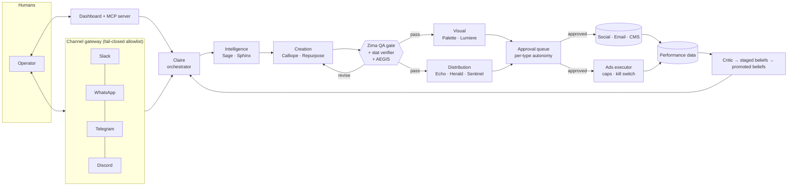

# Kaviyam

**A multi-agent marketing team that runs itself, with a human signing off on anything that leaves the building.**

Kaviyam plans a marketing sprint, researches it, writes it, designs it, renders the video, schedules it, and (within hard budget limits) puts ad money behind what's working. Humans approve each asset from where they already work: Slack, WhatsApp, Telegram or Discord.

I designed and built it on my own, starting in April 2026, using Claude Code as my engineering team.

**Status: private beta.** One design-partner tenant so far, ten weekly sprints run. Not generally available yet.

> This repo is a public showcase. The product source is private. Everything below describes the system as it runs in beta today, and every number is computed from the private repo.

The operator dashboard, shown under the product's earlier name, CLAIRE. Agents grouped by pipeline layer, each with its own model tier and an on/off switch.

---

## By the numbers

| | |
|---|---|
| Commits | 266 (Apr 2026 to now) |
| Python | ~75,000 lines |
| Tests | 1,604 across 112 test files |
| Agents | 17 active, 20 defined |
| Weekly sprints with a design partner | 10, each with a written retro |
| Tenants | Multi-tenant, isolated per tenant (database, memory, brand, credentials) |

---

## What it does

A sprint runs in three phases:

1. **Sequential:** research → long-form writing → SEO/AEO/GEO optimisation → QA gate
2. **Parallel:** social posts, email sequences, video concepts, carousel concepts, publishing schedule
3. **Render:** video concepts become Remotion `.tsx` and then `.mp4`; carousels render through Satori → resvg to PNG

Then it learns. Performance data (impressions, opens, clicks) flows back. A critic agent turns repeated patterns into staged *beliefs*. A belief is promoted only after enough evidence accumulates, and contradictions go to a human. The next sprint is written with those beliefs in context.

Sprint calendar: every content type, every week, with its approval state.

### The agent team

| Layer | Agents | Job |
|---|---|---|
| Orchestration | **Claire** (CMO) | The only agent a human talks to. Delegates, prioritises, reports back in one voice |
| Onboarding | **Janus** | Drafts a brand from a URL, guides integrations, diagnoses failures |
| Intelligence | **Sage**, **Sphinx** | Research briefs; competitive intel and SEO/AEO/GEO |
| Creation | **Calliope**, **Repurpose**, **Events** | Long-form and email copy; repurposing; event marketing |
| Quality | **Zima** | Scores every asset 1 to 10 against a rubric, approves or sends back, writes the sprint retro |
| Visual | **Palette**, **Lumiere** | Carousels; video concepts → code → rendered video |
| Distribution | **Echo**, **Herald**, **Sentinel** | Social, email sequences, scheduling + UTM + the approval queue |
| Demand | Ads, ABM, audience modules | Paid campaigns on Google, Meta, LinkedIn and X; account-based sequences |

Each agent is a spec file plus a model tier. The model layer is backend-agnostic: the Anthropic API, OpenRouter or a local CLI, chosen per deployment.

---

## The part I care about most: trust

Generating content is the easy bit. The hard part is letting agents act without someone babysitting them. Most of the engineering went here.

**Autonomy is a per-person, per-content-type setting, not a global switch.**
Each content type (blog, LinkedIn post, DM, email, carousel, video, paid ads, inbox reply) runs in one of three modes for each operator: `assist`, `draft` or `autonomous`. Autonomous mode can also require a minimum confidence score. The default is `assist`.

**Ads have hard limits that the model cannot talk its way past.**
Guardrails sort every proposed ad action into allowed, needs-approval or hard-block. A kill switch, a hard budget cap breach or an invalid budget is a hard block, and the executor re-checks those gates at execution time, not just at planning time. Actions that *reduce* risk (pausing, lowering spend) are always allowed, even under the kill switch.

**Every number needs a source.**
Early on, the copywriting agent produced confident statistics that came from nowhere ("According to a 2024 report, 73% of..."). The QA rubric flagged it but didn't block it. So there is now a deterministic **stat verifier**: every statistical claim needs a URL, footnote or attribution nearby, or it's flagged with line numbers before anything publishes.

**Untrusted text gets screened.**
**AEGIS** scores inbound content for prompt injection in two tiers: a free regex pass on everything, and a model-based classifier for genuinely untrusted input like scraped web pages, where regex alone misses indirect injection.

**Channels fail closed.**
The chat gateway (Telegram, Discord, Slack, WhatsApp) authorises every sender against a per-channel allowlist. An empty allowlist denies everyone. It is outbound-only: no public webhooks, works behind NAT.

**Integrations are watched.**
A watchdog checks every connected integration every 30 minutes and tells the operator, over Discord and WhatsApp, the moment one changes state.

The approval pattern became its own open protocol: **[counter-sign](https://github.com/countersign-labs/counter-sign)**, a spec for how agents ask a human to authorise an action (Intent, Route, Countersignature, Default). It's on npm and submitted as an IETF Internet-Draft.

---

## Architecture

**Per-tenant isolation.** Each tenant has its own SQLite performance database, memory, brand files and secrets. A tenant registry binds each inbound channel to exactly one tenant, and a stub tenant exists only to prove in tests that data can't cross over.

**Brand Brain.** Brand voice, audiences and positioning live as plain files that agents read and humans can edit. No vector database is needed to know how a brand talks.

**MCP server.** Kaviyam exposes itself as an MCP server, so Claude Desktop, Claude Code or any MCP client can query content, the approval queue and pipeline state, and approve or reject with an admin key.

**Integrations.** HubSpot and DreamTeam CRM, Brevo, Listmonk and Substack for email, Postiz for scheduling, Google Analytics, LinkedIn analytics, and AI video providers, all behind one integration manifest with a health doctor.

---

## How I build

I'm a designer by background: seven years across McKinsey client presentations, B2B SaaS brand and AI consulting. Kaviyam is written with Claude Code as the engineering team and me as the architect, reviewer and product owner.

What that looks like in practice:
- **Specs first.** Every agent is a Markdown spec before it's code.
- **Tests as the contract.** 1,604 tests, so a change to one agent can't quietly break another.
- **Weekly retros**, written by the QA agent and me, that decide what changes next sprint.
- **Fail closed by default.** Permissions, channels and ad spend all start at "no".

---

**Haridarman Kumaresan (Disco Darman)** · Bengaluru, India · open to remote work
[LinkedIn](https://www.linkedin.com/in/hari-darman-466644177) · [counter-sign](https://github.com/countersign-labs/counter-sign)
